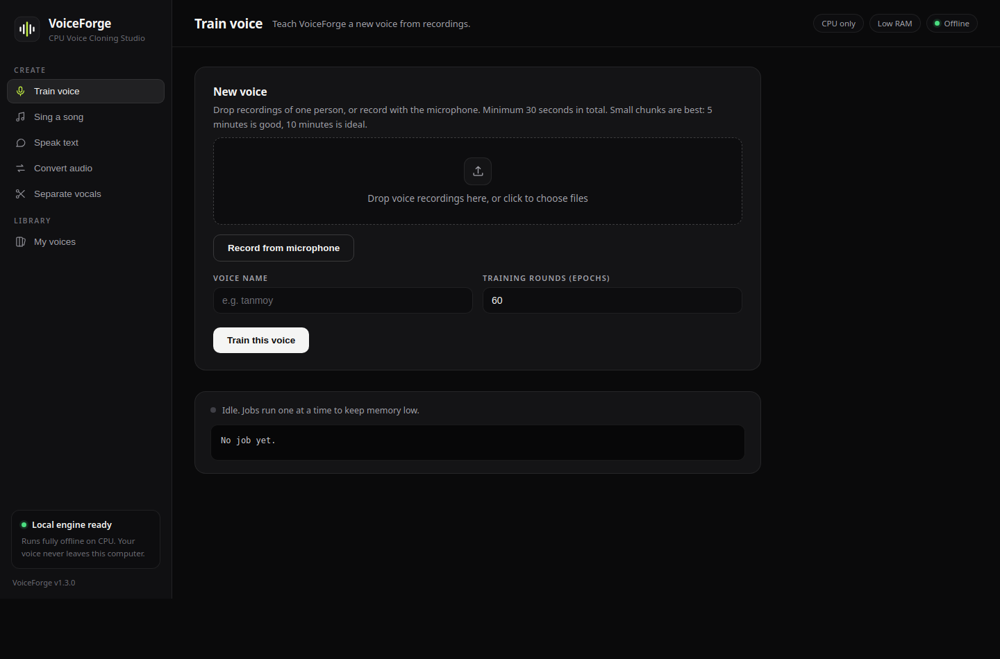
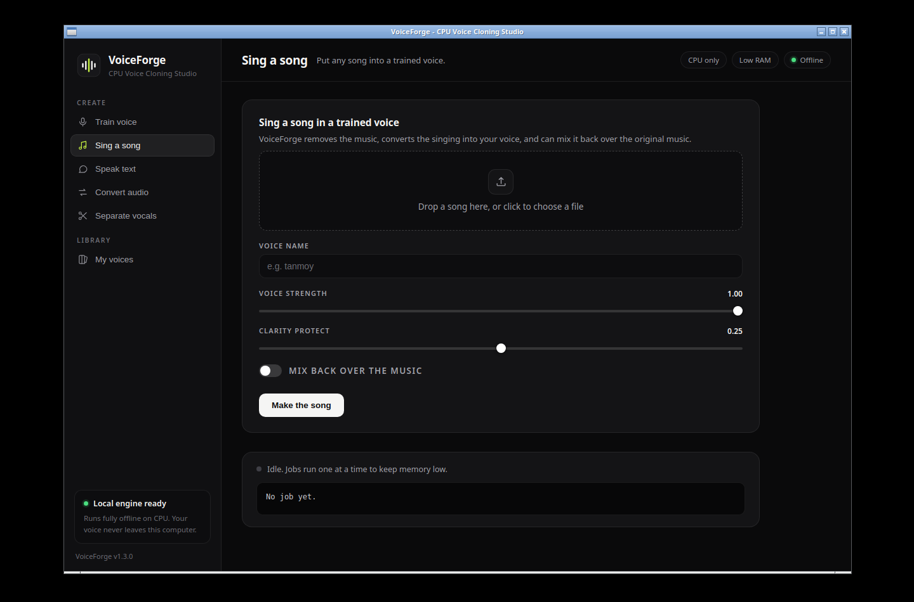
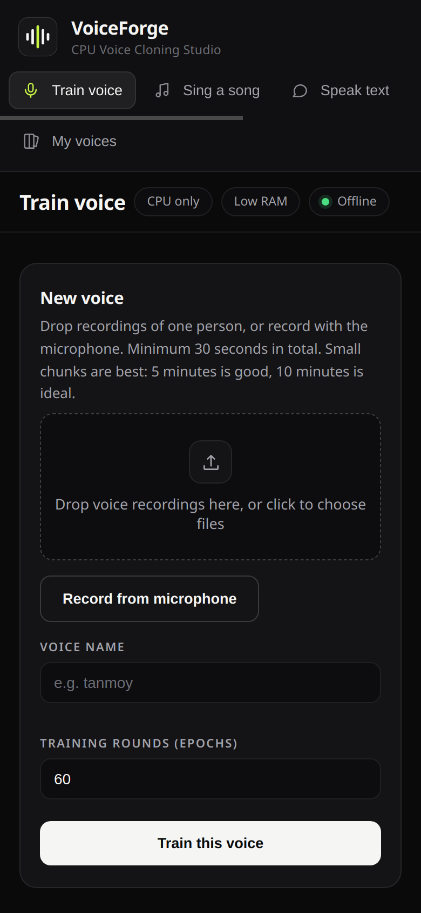

<p align="center">
  
</p>

<h1 align="center">VoiceForge</h1>

<p align="center"><b>Clone any voice. Make it speak or sing. On a normal computer, with no GPU.</b></p>

<p align="center">
  <a href="https://github.com/Tcode-Motion/VoiceForge/actions/workflows/ci.yml"></a>
  <a href="https://github.com/Tcode-Motion/VoiceForge/releases"></a>
  
  
  
  
  
</p>

---

## About

VoiceForge is a voice cloning studio built for ordinary machines: a
laptop or mini PC with a plain CPU and as little as 4 GB of RAM.

Record a short sample of a voice. Train a model on your own computer.
Then make that voice speak typed text or sing any song. Everything
runs locally. Nothing is uploaded anywhere, ever.

VoiceForge was designed, tested and benchmarked on a small 4 vCPU /
8 GB RAM / no-GPU machine, and every design decision follows from
that constraint. If it runs well there, it runs well anywhere.

> **Privacy by design:** after the one-time engine setup, VoiceForge
> works with the network off. Your recordings, your models and your
> results never leave your machine.

---

## Screenshots

<p align="center">
  
  
</p>

<p align="center"><i>The web GUI (left) and the desktop app for Windows, macOS and Linux (right). One design across both: sidebar, cards, dropzones, sliders and the job console.</i></p>

<p align="center">
  
</p>

<p align="center"><i>The Android and iOS companion apps show the same studio on your phone, with a touch friendly layout, and run the engine on your computer.</i></p>

---

## What you can do

| Mode | What it does |
|---|---|
| Train | Learn a voice from your recordings: 30 seconds minimum, 5 minutes recommended, 10 minutes ideal |
| Sing | Give it any song. It separates the singing, converts it into your trained voice, and can mix it back over the original music |
| Speak | Type any text and hear it spoken in the trained voice |
| Convert | Turn any voice recording into the trained voice, with sliders for voice strength and clarity |
| Separate | Split any song into clean vocals and instrumental |

Four interfaces, one engine: a **web GUI**, a **desktop GUI**, a
**terminal menu (TUI)** and a scriptable **CLI**.

## Why VoiceForge

| | VoiceForge | Cloud cloning services | GPU desktop tools |
|---|---|---|---|
| GPU needed | No, plain CPU | No (their servers) | Yes, usually |
| Your voice is uploaded | Never | Yes | No |
| Monthly cost | Free, open source | Subscription | Free |
| Works offline | Yes, fully | No | Yes |
| Minimum RAM | 4 GB | n/a | 8 to 16 GB |
| Runs on an old laptop | Yes, by design | n/a | Rarely |

---

## Get the apps

Packaged builds are produced by CI and attached to each GitHub
release:

- **Windows**: VoiceForge-Windows.zip (desktop app, .exe inside)
- **macOS**: VoiceForge-macOS.zip (.app inside)
- **Linux**: VoiceForge-Linux.tar.gz
- **Android**: companion app (APK built by CI). It runs the studio
  interface on your phone and connects to the engine on your computer
- **iOS**: companion app (simulator build in CI; a device build needs
  your own Apple Developer signing)

Or run it from source with the quick start below.

## Quick start

```bash
# 1. Install the engines (one time; Applio/RVC, Demucs, Kokoro, all CPU builds)
bash scripts/setup_engines.sh

# 2. Install VoiceForge itself (Python standard library only, no dependencies)
pip install .

# 3. Make a voice
voiceforge add-voice myvoice recording1.wav recording2.wav
voiceforge train myvoice --epochs 60

# 4. Use it
voiceforge sing favourite_song.mp3 --voice myvoice --with-music -o my_cover.wav
voiceforge speak "Hello, this song is in my own voice" --voice myvoice -o hello.wav
voiceforge convert interview.mp3 --voice myvoice -o interview_mine.wav

# 5. Or open a GUI
voiceforge gui        # web app at http://127.0.0.1:8760
voiceforge desktop    # desktop window
voiceforge tui        # terminal menu
```

---

## System requirements

| | Minimum | Recommended |
|---|---|---|
| CPU | Any modern dual-core | 4 cores |
| RAM | 4 GB | 8 GB |
| GPU | None | None |
| Disk | A few GB free for the engines | 10 GB free |
| OS | Windows 10+, macOS 12+, Linux | Same |
| Python | 3.10 or newer (source installs) | 3.12 |

## Real timings (measured on the reference machine)

Reference machine: 4 vCPU, 8 GB RAM, no GPU, plain CPU builds.

| Job | Time |
|---|---|
| Train, per round (epoch) | About 1.5 minutes |
| Speak one short line, end to end | About 1 minute |
| Convert a 6 second clip | About 40 seconds |
| Sing mode on a 6 second clip | About 1 minute |
| Sing mode on a full 48 second song | About 3 minutes |
| Separate a typical song | About a minute |

A stronger computer is faster across the board. Nothing here needs a
GPU at any point.

---

## Guidelines: getting a good voice

| Sample length | Result |
|---|---|
| Under 30 seconds | Rejected (too little to learn a voice) |
| 30 seconds to 2 minutes | Recognisable, rough |
| 5 minutes | Good |
| 10 minutes, in small chunks | Best |

- Record in a quiet room, natural talking voice, no music behind you.
- Small chunks (a few minutes each) beat one long noisy file.
- Voice strength (index rate) 1.0 copies the trained voice fully;
  0.85 is gentler. Clarity protect around 0.25 keeps words crisp.
- More clean voice in, more of you out. This is the whole secret.

## How it works

VoiceForge is a careful conductor for three proven open-source
engines, each run as a short-lived process so only one is ever in
memory:

| Stage | Engine | Job |
|---|---|---|
| Separate | Demucs (htdemucs) | Splits a song into vocals and instrumental |
| Train + convert | Applio (RVC v2, HiFi-GAN, 40 kHz) | Learns a voice and converts singing or speech onto it |
| Pitch tracking | RMVPE | Extracts the melody accurately, even from noisy vocals |
| Voice features | ContentVec (HuBERT) | Reads the identity of a voice for training and conversion |
| Speak | Kokoro TTS (82M, ONNX) | Turns typed text into natural speech, then RVC moves it onto your voice |

Every result is finished with the same mastering chain: gentle high
pass, presence EQ, light compression, and loudness normalised to
-14 LUFS with a -1.5 dB true peak ceiling, so outputs are ready to
share as they are.

## Built for low-end machines

Most voice tools assume a gaming GPU. VoiceForge assumes the opposite
and is engineered around it (details in
[docs/LOW_RESOURCE.md](docs/LOW_RESOURCE.md)):

- **Chunked conversion**: long audio is converted in 30-second
  chunks, each in a fresh process, joined with crossfades. Peak RAM
  stays flat for a 1-minute clip or a 1-hour concert.
- **One engine at a time**: engines load, work, and exit before the
  next stage starts.
- **Memory-safe training**: batch size 1, gradient checkpointing,
  weights-only checkpoints saved regularly.
- **Small separation windows**: Demucs runs with a 7-second segment.
- **Right-sized models**: RMVPE pitch tracking, ContentVec features,
  and an 82M-parameter TTS that is fast on CPU.
- **Safe temp location**: engines never depend on a small system
  temp folder.

---

## Honest scope

- Speak mode **speaks** text in your voice. It does not invent a
  melody: to sing, use Sing mode with a real song so the tune and
  timing come from the original singer.
- Quality follows the sample. More clean voice in, more of you out.
- Training is the slow part on CPU. A short song conversion takes a
  few minutes. Plan a coffee, not a holiday.
- The Android and iOS apps are companions: they run the studio
  interface and connect to the VoiceForge engine on your computer
  (same network). The heavy engines stay on the computer, which is
  what keeps the phone apps small and fast.

## FAQ

**Do I need a GPU?**
No. VoiceForge was built specifically for machines without one.

**Does my voice data go to any server?**
No. After the one-time setup downloads, everything runs offline on
your computer. There are no accounts and no uploads.

**Can it sing lyrics I type?**
Not with a new melody. Speak mode reads text aloud in your voice.
For singing, give Sing mode a real song: the melody and timing come
from the original singer, the voice becomes yours.

**Which languages work?**
Conversion (Sing and Convert modes) works on a real recording, so it
follows whatever language the original singer or speaker used. Speak
mode depends on the TTS voice and is strongest in English.

**How good will my clone be?**
It follows your sample. Thirty seconds gives a recognisable but rough
voice. Five to ten minutes of clean, natural talking gives a strong
one. The guidelines table above is the honest scale.

**Can I use it on my phone?**
Yes, with the companion apps. Your phone runs the studio interface
and your computer does the heavy work over your own network.

---

## Project layout

```
src/voiceforge/     the studio (CLI, TUI, web GUI, desktop GUI, pipeline)
scripts/            one-time engine installer
docs/               usage, low-resource design notes, troubleshooting
packaging/          PyInstaller spec for the desktop apps
android/            Android companion app (Kotlin, WebView)
ios/                iOS companion app (Swift, WKWebView)
.github/workflows/  CI tests + app builds + release automation
```

## Contributing

Contributions are welcome. Read [CONTRIBUTING.md](CONTRIBUTING.md)
and the [Code of Conduct](CODE_OF_CONDUCT.md) first. The one hard
rule: VoiceForge must stay runnable on a plain CPU with 4 GB of RAM.

## Security

See [SECURITY.md](SECURITY.md) for the security policy and how to
report a problem. Short version: VoiceForge runs fully offline after
setup; your voice data never leaves your machine.

## Changelog

See [CHANGELOG.md](CHANGELOG.md). If something breaks, start with
[docs/TROUBLESHOOTING.md](docs/TROUBLESHOOTING.md).

## License

MIT. See [LICENSE](LICENSE). The engines VoiceForge drives keep their
own licenses: Applio/RVC (MIT), Demucs (MIT), Kokoro (Apache-2.0).

## Ethics

Only clone voices you own or have clear permission to use. VoiceForge
runs locally precisely so your voice data never has to leave your
machine.
